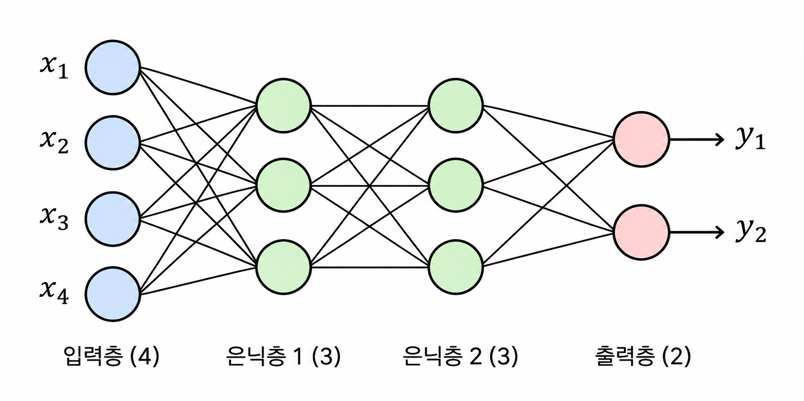

# MLP 구조

## MLP란?
입력층(Input Layer), 하나 이상의 은닉층(Hidden Layer), 출력층(Output Layer)으로 구성된 인공신경망

## MLP 구조

인접한 두 층의 뉴런이 모두 연결된 완전연결층(Fully Connected Layer) 을 사용함

## MLP 연산과정
은닉층에서 입력값이 전달되면 가중합 계산 및 활성화함수를 적용함.

가중합 계산: 각 뉴런은 이전 층에서 전달받은 입력값에 가중치를 곱하고 편향을 더하여 가중합을 계산한다.

$$
z_j = \sum_{i=1}^{n} w_{ji}x_i + b_j
$$

- $x_i$: 입력값
- $w_{ji}$: 입력 뉴런 $i$와 뉴런 $j$ 사이의 가중치
- $b_j$: 편향(Bias)
- $z_j$: 가중합

활성화 함수 적용: 계산된 가중합에 활성화 함수를 적용하여 뉴런의 출력값을 결정한다.

$$
a_j = f(z_j)
$$

대표적인 활성화 함수인 ReLU는 다음과 같다.

$$
\mathrm{ReLU}(z) = \max(0, z)
$$

- $z_j$: 가중합
- $f$: 활성화 함수
- $a_j$: 활성화 함수를 적용한 출력값

## MLP 학습 과정
입력데이터 → 순전파 → 손실 함수 → 역전파 → 옵티마이저

### 순전파
순전파는 입력 데이터를 이용하여 예측값을 계산함.
각 뉴런이 이전층의 출력값을 입력받아 가중합을 계산한 후, 활성화 함수를 적용함.

- 가중합 계산
$$
z_j^{(l)} = \sum_{i=1}^{n} w_{ji}^{(l)} a_i^{(l-1)} + b_j^{(l)}
$$

- 활성화 함수 적용
$$
a_j^{(l)} = f(z_j^{(l)})
$$
